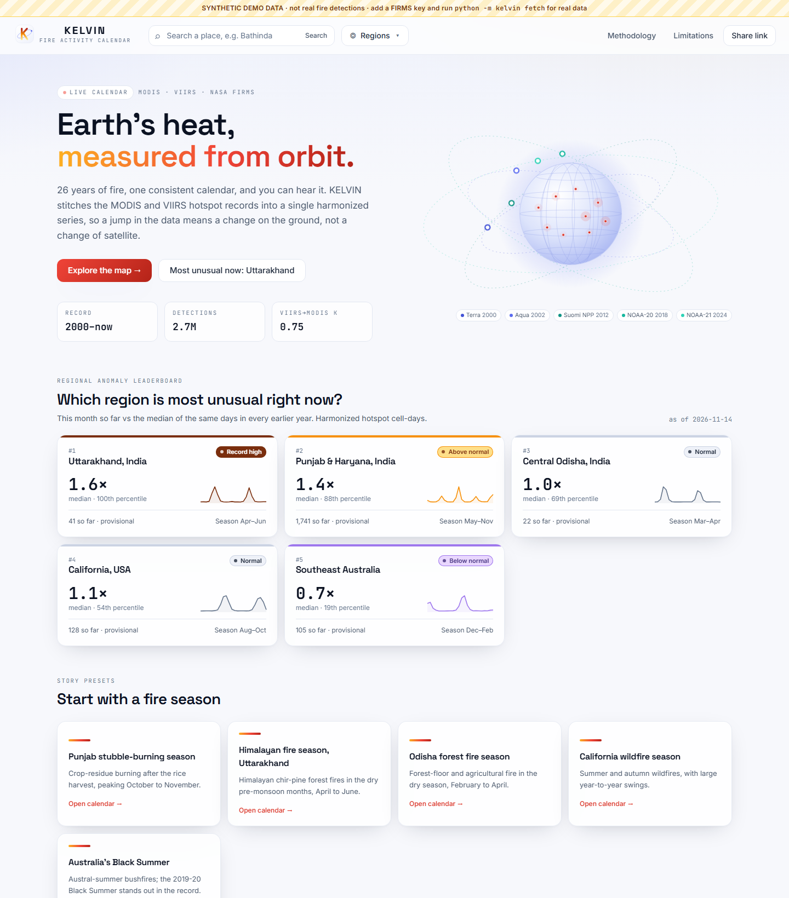
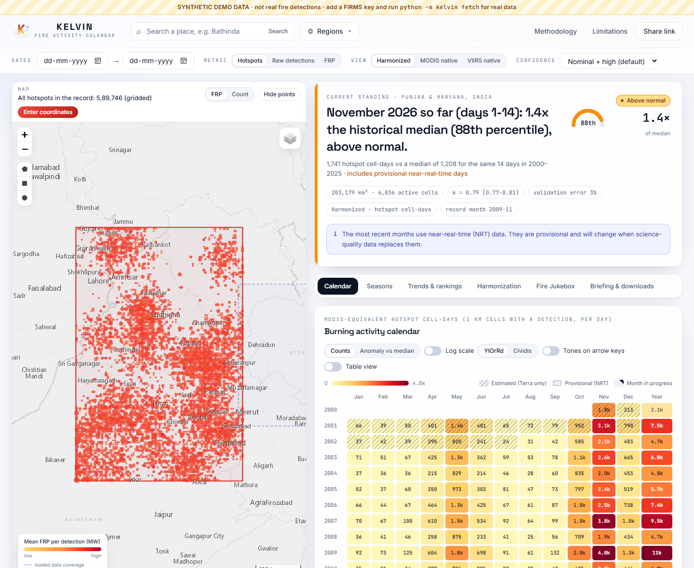
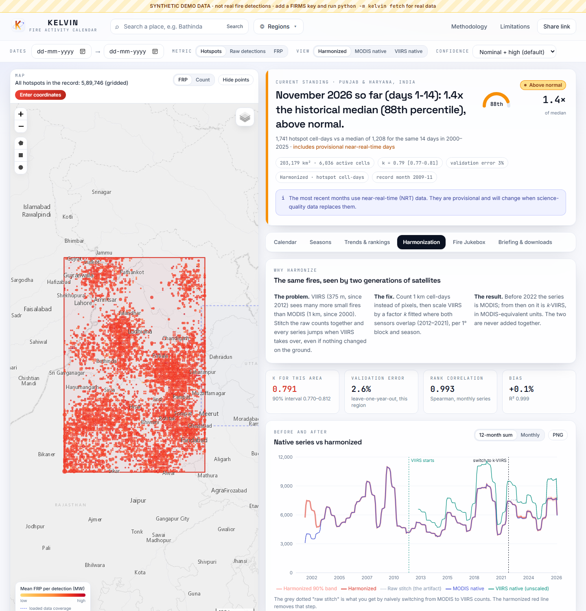
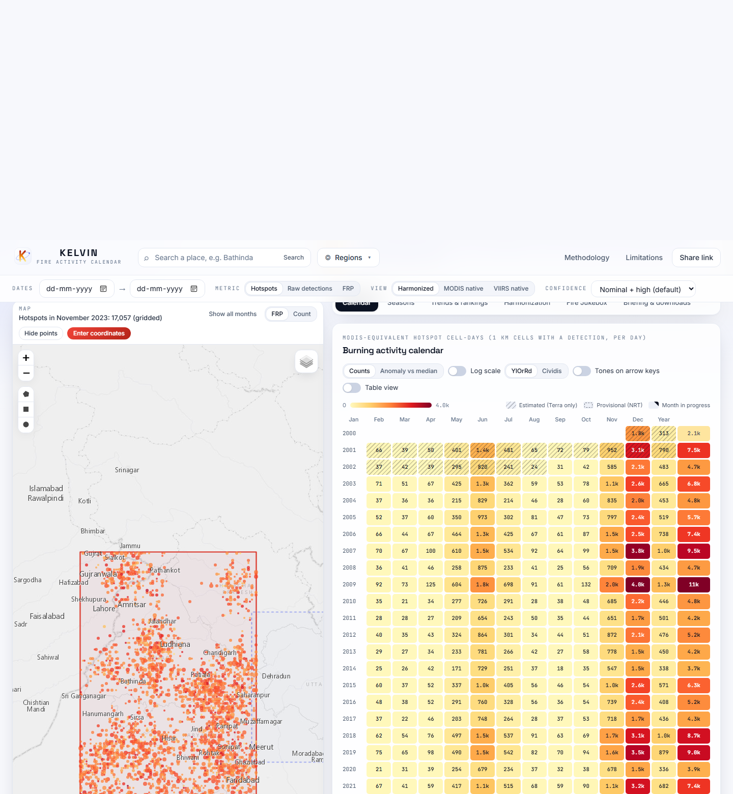
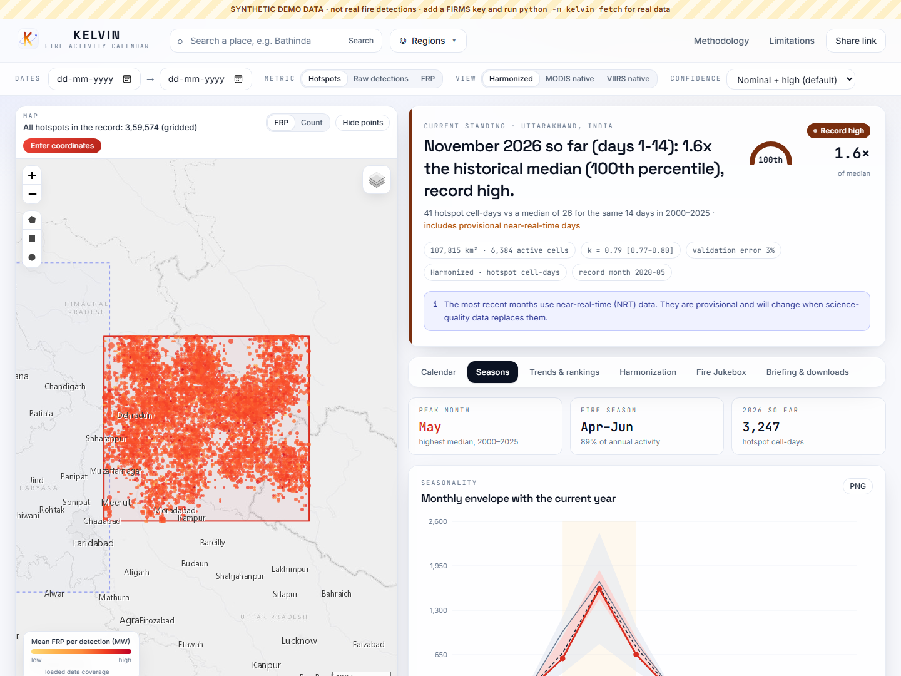
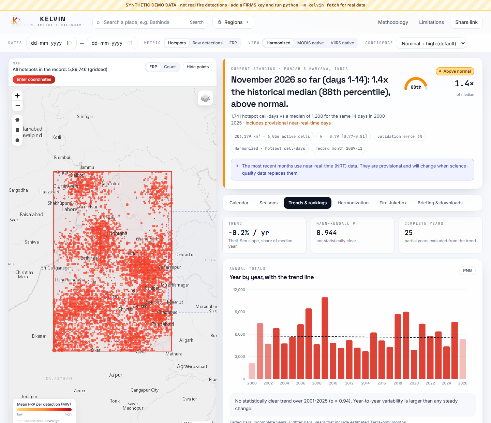
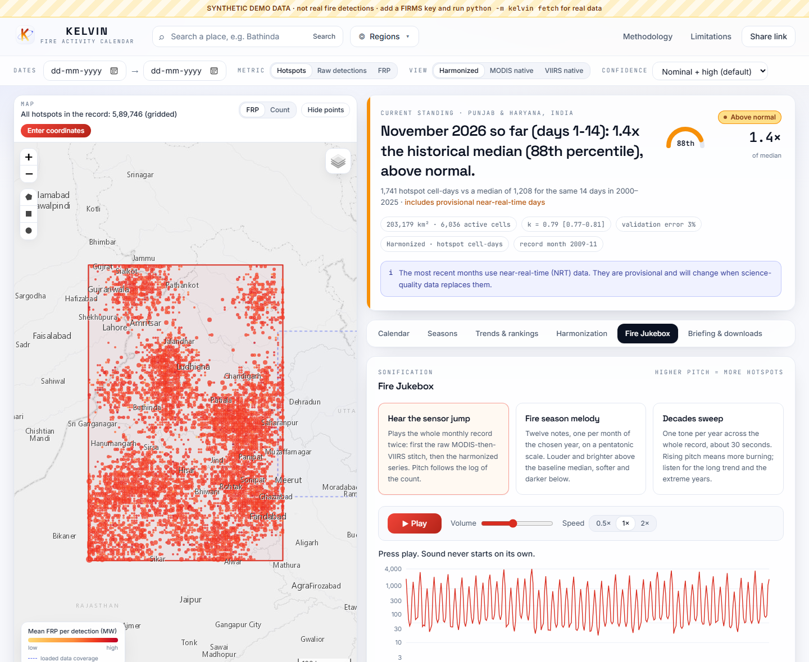
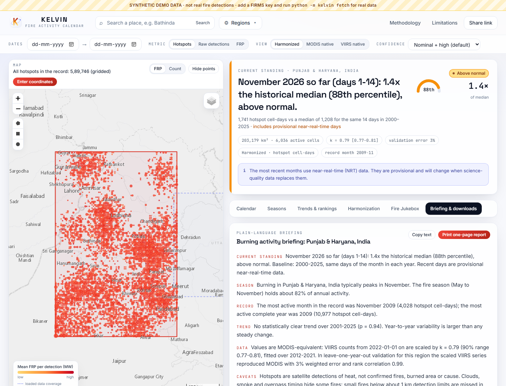
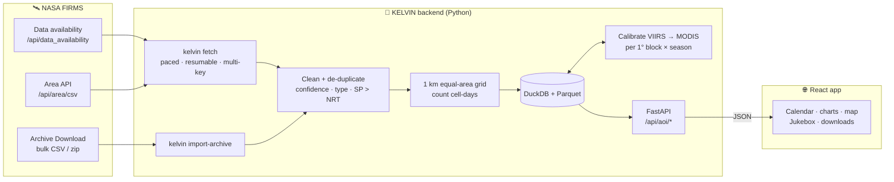

<div align="center">


# KELVIN

### Earth's heat, measured from orbit.

**25 years of satellite fire data on one consistent calendar, and you can hear it.**

[](https://www.spaceappschallenge.org/)
[](https://firms.modaps.eosdis.nasa.gov/)
[](#-how-we-use-nasa-data)


*Challenge: **MODIS and VIIRS Hot Spots***

</div>

<p align="center">
  
</p>

> [!NOTE]
> The screenshots show **synthetic demo data** while our real FIRMS download finishes. The app says so in a banner on every screen and in every CSV. Nothing synthetic is presented as real.

---

## 🔥 The problem in one picture

NASA has watched Earth's fires from space since 2000, but with two generations of instruments:

| | **MODIS** (Terra, Aqua) | **VIIRS** (Suomi NPP, NOAA-20, NOAA-21) |
|---|---|---|
| Flying since | Nov 2000 / Jul 2002 | Jan 2012 / Apr 2018 / Jan 2024 |
| Pixel size | 1 km | 375 m |
| Sees small fires? | Often misses them | Yes, many more |
| Status | Ageing, being retired | The future |

Join the raw counts and almost every region seems to burn far more after 2012. **That jump is the satellite changing, not the fire.** A fire officer asking *"is this season worse than usual?"* can't get a fair answer from the raw record.

**KELVIN removes the jump**, then builds a burning-activity calendar, anomaly alerts and downloads on top of the harmonized record.

---

## ✨ What you can do

<table>
<tr>
<td width="50%" valign="top">

### 📅 Burning activity calendar
Every year × every month since 2000, colour-ramped, **with the number in every cell**. Switch to an anomaly view against the historical median. Hatched cells are Terra-only estimates; dashed cells are provisional near-real-time data.

</td>
<td width="50%" valign="top">

### 🚨 Is this month unusual?
A plain-language banner for emergency managers: *"November so far: 1.4× the historical median, 88th percentile, above normal."* This month is compared only with **the same days** in earlier years, never with full months.

</td>
</tr>
</table>

<p align="center"></p>

<table>
<tr>
<td width="50%" valign="top">

### 🔬 Harmonization you can check
Raw MODIS, raw VIIRS and the harmonized series side by side, so you can watch the 2012 jump disappear. Also shown: uncertainty bands, an out-of-sample scatter, leave-one-year-out validation per region, and every calibration factor with how it was estimated.

</td>
<td width="50%" valign="top">

### 🎵 Fire Jukebox
The record as sound, all synthesized in the browser. **"Hear the sensor jump"** plays the raw record, then the harmonized one. Also: a fire-season melody, a 25-year sweep, and a campfire crackle for daily counts. Every mode has a written description.

</td>
</tr>
</table>

<p align="center"></p>

<details>
<summary><b>📸 More screenshots: daily drill-down, seasons, trends, jukebox, briefing</b></summary>
<br/>

**Daily drill-down.** Click any month to see each day against its historical range. That month's hotspots light up on the map.


**Seasons.** The monthly envelope (min–max, middle 50%, median) with this year and last year on top. The fire-season window is shaded.


**Trends and rankings.** Annual totals with a Theil–Sen trend and Mann–Kendall test, worded carefully, plus the top 10 months and years.


**Fire Jukebox**


**Briefing and downloads.** A deterministic briefing, CSV downloads and a printable one-page report.


</details>

**Also included:** draw a rectangle, polygon or circle; type coordinates; upload GeoJSON; or search any place · streaming **CSV of every hotspot** · chart PNG export · **shareable links** (the whole view lives in the URL) · a home-screen **leaderboard** of the most unusual regions · full **keyboard** and **screen-reader** support · colorblind-safe ramps.

---

## 🛰️ How we use NASA data

All fire data comes from **[NASA FIRMS](https://firms.modaps.eosdis.nasa.gov/)** (Fire Information for Resource Management System, part of LANCE/EOSDIS). It publishes every active-fire detection from MODIS and VIIRS: location, time, satellite, confidence and fire radiative power.



### The FIRMS endpoints we call

| What | Endpoint | How KELVIN uses it |
|---|---|---|
| **Fire detections** | `GET /api/area/csv/{MAP_KEY}/{SOURCE}/{w,s,e,n}/{days}/{date}` | Downloads each region in tiles of up to 10° and windows of up to 5 days. Six parallel workers, retries with back-off, and resumable: finished chunks are skipped on a re-run. |
| **What exists, and until when** | `GET /api/data_availability/csv/{MAP_KEY}/ALL` | Called before every download, so no dates are hard-coded. It tells us where science-quality data ends and near-real-time begins. |
| **Key usage** | `GET /mapserver/mapkey_status/?MAP_KEY=…` | Checked every 20 requests. A key near its limit rests for a minute while other keys keep working. |
| **25-year history** | [FIRMS Archive Download](https://firms.modaps.eosdis.nasa.gov/download/) | Bulk files for big areas and long periods. `kelvin import-archive` auto-detects the sensor and satellite. |

### The FIRMS sources

| Source | Satellite | Pixel | We use it for |
|---|---|---|---|
| `MODIS_SP` · `MODIS_NRT` | Terra + Aqua | 1 km | The 2000–2021 backbone of the record |
| `VIIRS_SNPP_SP` · `_NRT` | Suomi NPP | 375 m | The VIIRS reference, calibrated against Aqua MODIS (same ~13:30 overpass) |
| `VIIRS_NOAA20_SP` · `_NRT` | NOAA-20 | 375 m | Chained to Suomi NPP for continuity |
| `VIIRS_NOAA21_SP` · `_NRT` | NOAA-21 | 375 m | Chained to NOAA-20 |

**SP** (standard processing) is science-quality and arrives months later. **NRT** (near-real-time) arrives within hours. We use SP wherever it exists, NRT only after the last SP day, and **every NRT value is flagged "provisional"** in the app and in downloads.

### About the MAP_KEY

FIRMS needs a free **MAP_KEY** for programmatic downloads. It's NASA's fair-use control, at about 5,000 transactions per 10 minutes per key. In KELVIN:

- **It never leaves the server.** It lives in a local `.env` file that is gitignored, so neither the browser nor GitHub ever sees it.
- **Several keys can share the load.** List them comma-separated (`FIRMS_MAP_KEY=key1,key2`) and requests rotate between them.
- **It's only needed to download.** Once data is built, the app runs entirely from the local database.

---

## 🗺️ How we use map APIs

The map is **[Leaflet](https://leafletjs.com/)** with **leaflet-draw** for drawing areas. Tiles and place search load straight from the browser; our backend isn't involved.

| Service | Used for | Key needed? |
|---|---|---|
| [Esri World Light Gray Canvas](https://www.arcgis.com/home/item.html?id=ed712cb1db3e4bae9e85329040fb9a49) (base + labels) | Default light basemap, place names drawn above the fire dots | No |
| [OpenStreetMap](https://www.openstreetmap.org/copyright) tiles | Street basemap option | No |
| [Esri World Imagery](https://www.arcgis.com/home/item.html?id=10df2279f9684e4a9f6a7f08febac2a9) | Satellite basemap option | No |
| [Nominatim](https://nominatim.org/) (OpenStreetMap) | Place search → bounding box | No. Called once per search (never per keystroke), per its usage policy |

**Fire points on the map** come from our own `/api/aoi/hotspots` endpoint. Under 4,000 detections, you get every point, colored by fire radiative power or year (click one for date, time and satellite). Above that, the backend aggregates to a grid sized to your area, so the map stays fast with hundreds of thousands of detections. A dashed outline shows where data is loaded, and areas outside it get a clear warning.

---

## 🧪 The harmonization, in five steps

1. **Common unit.** Snap every detection to a ~1 km **equal-area** cell (MODIS sinusoidal grid) and count **cell-days**: cells with a detection on a given day. This absorbs most of the 375 m vs 1 km difference and the different numbers of satellite passes.
2. **Calibrate in the overlap (2012–2021).** Fit `k = ΣMODIS / ΣVIIRS` per **1° block × season**. Thin blocks borrow strength from their 10° region, then the globe (hierarchical shrinkage). A bootstrap over years gives a 90% interval. The window stops in 2021 because MODIS orbits have drifted since then.
3. **Terra-only months** (Nov 2000–Jul 2002): scale Terra up with a factor learned from 2003–2006, and mark the months *estimated*.
4. **Assemble.** MODIS before 2022, **k × VIIRS** from 2022 on. **Never the sum**: in the overlap both sensors see the same fires.
5. **Validate.** Leave one year out, refit, and predict that year's MODIS from VIIRS alone. Error, bias, R² and rank correlation per region are all shown in the app.

On synthetic data with a planted answer, the calibration recovers the true factor **within 6%** (seasonal k) and **8%** (Terra factor). That's an automated test. Full method: **[docs/METHODOLOGY.md](docs/METHODOLOGY.md)**.

---

## 🚀 Quick start (Windows 11, PowerShell)

Needs **Python 3.11+** and **Node.js 20+**.

```powershell
git clone https://github.com/akshitag001/Kelvin.git
cd Kelvin
python -m venv .venv
.\.venv\Scripts\Activate.ps1
pip install -r requirements.txt
pip install -e .
python scripts/dev.py
```

Open the **App** link it prints (normally **http://localhost:5173**). The first run builds the demo dataset (about 2 minutes). If port 8000 or 5173 is busy, `dev.py` picks the next free port by itself.

<details>
<summary><b>Load real NASA data</b></summary>

```powershell
Copy-Item .env.example .env
notepad .env                        # FIRMS_MAP_KEY=your_key   (free: https://firms.modaps.eosdis.nasa.gov/api/map_key/)
python scripts/pilot_fetch.py       # probe → download priority regions → build → check
```

For the full 25-year history over large areas, use **[FIRMS Archive Download](https://firms.modaps.eosdis.nasa.gov/download/)**: request MODIS C6.1 plus each VIIRS satellite as CSV, put the files in `data/raw/manual/`, then run:

```powershell
python -m kelvin import-archive
python -m kelvin refresh            # later: top up the last 15 days of near-real-time data
```
</details>

<details>
<summary><b>All CLI commands</b></summary>

| Command | Does |
|---|---|
| `python -m kelvin demo-data` | Generate synthetic data with a known answer, then build and calibrate |
| `python -m kelvin probe` | Check keys, list FIRMS coverage, sample columns |
| `python -m kelvin fetch [--priority N] [--start YYYY-MM-DD]` | Download through the FIRMS API (paced, resumable, multi-key) |
| `python -m kelvin import-archive [folder]` | Import FIRMS archive CSV or zip files |
| `python -m kelvin build` | Clean → grid → aggregate → calibrate |
| `python -m kelvin calibrate` | Re-fit the harmonization only |
| `python -m kelvin refresh` | Top up near-real-time data and rebuild |
| `python -m kelvin check` | Sanity checks (e.g. Punjab should peak in Oct–Nov) |
| `python scripts/dev.py [--prod]` | Run the app (dev, or a single production process) |
| `python scripts/screenshots.py` | Re-capture these README screenshots |
</details>

---

## 🏗️ Under the hood

| Layer | Stack |
|---|---|
| Processing | Python 3.11 · pandas · NumPy · SciPy · Shapely |
| Storage | DuckDB + Parquet: one file, no database server, area summaries in ~0.1–0.3 s |
| API | FastAPI · Pydantic · Uvicorn: one process also serves the built site |
| Frontend | React 18 · TypeScript · Vite · Tailwind CSS |
| Map | Leaflet · leaflet-draw |
| Charts | Recharts · d3-scale · d3-scale-chromatic (YlOrRd, Cividis, PuOr) |
| Sound | Web Audio API: synthesized, no audio files |
| Tests | pytest (43) · Vitest + Testing Library (7) |

<details>
<summary><b>Our API endpoints</b></summary>

| Endpoint | Returns |
|---|---|
| `GET /api/status` | Coverage, last refresh, SP/NRT boundary, demo flag |
| `GET /api/regions` | Preset regions and whether data is loaded |
| `POST /api/aoi/summary` | Monthly series (3 views + band), calendar, anomalies, current standing, seasonality, trend, rankings, warnings |
| `POST /api/aoi/daily` | Daily values for a month plus historical envelope and month-to-date comparison |
| `POST /api/aoi/hotspots` | GeoJSON points, or a grid when there are many |
| `POST /api/aoi/hotspots.csv` | Streaming CSV of every detection, with a provenance header |
| `POST /api/aoi/calendar.csv` | Monthly harmonized table |
| `POST /api/aoi/briefing` | Template-based plain-language briefing |
| `GET /api/harmonization/diagnostics` | Scatter, k table, cross-validation, Terra factor |
| `GET /api/leaderboard` | Regions ranked by current anomaly |

Every area endpoint accepts a GeoJSON polygon, a bbox, a point + radius, or a preset region, plus dates, metric, view, confidence and baseline years. Interactive docs are at `/docs` while the API runs.
</details>

<details>
<summary><b>Repository layout</b></summary>

```
backend/kelvin/   api/ · ingest/ (FIRMS client, cleaning, archive, demo) · process/ (build, check)
                  harmonize/ (calibrate, apply) · analytics/ (AOI, stats, summary, briefing) · cli.py
backend/tests/    pytest suite
frontend/src/     components/ (Map, Calendar, Harmonization, Jukebox, …) · lib/ (api, state, colors, audio)
config/           regions.yaml · settings.yaml (every default, documented)
scripts/          dev.py · pilot_fetch.py · screenshots.py
docs/             METHODOLOGY · DECISIONS · DATA_SOURCES · DEMO_SCRIPT · AI_USAGE · screenshots/
```
</details>

---

## ✅ Honest status

| | |
|---|---|
| Harmonization recovers a known answer | ✅ Automated test on synthetic data |
| Pipeline, API, CSV, accessibility | ✅ 50 automated tests |
| Live FIRMS API matches our code | ✅ Probed 14 Nov 2026 ([docs/DATA_SOURCES.md](docs/DATA_SOURCES.md)) |
| Real-data calibration and validation | ⏳ Download running for Punjab–Haryana, Uttarakhand and Odisha; the numbers will be published here |

**Limitations we show in the app:** a hotspot is a detection of heat, not a burned area or a cause · clouds and smoke hide fires · polar orbiters pass only a few times a day · VIIRS sees small fires MODIS can't · static heat sources are removed only where FIRMS flags them · recent data is provisional.

---

## 🙏 Attribution

Fire data: **NASA FIRMS** (LANCE/EOSDIS), MODIS Collection 6.1 and VIIRS 375 m active fire products. *NASA does not endorse this project.*
Basemaps © Esri, HERE, Garmin, © OpenStreetMap contributors · Geocoding by Nominatim (OpenStreetMap).

<div align="center">
<sub>Built for NASA Space Apps Challenge 2026 by <a href="https://github.com/akshitag001">akshitag001</a></sub>
</div>
